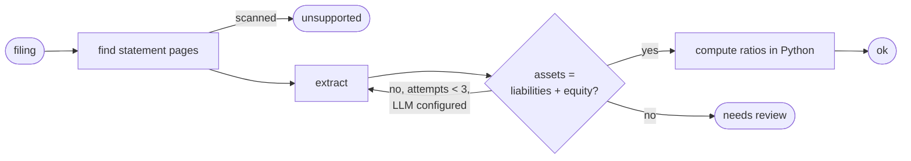

# bursa-filing-agent

[](https://github.com/Downey112/bursa-filing-agent/actions/workflows/ci.yml)

An agent that reads Bursa Malaysia quarterly reports, pulls out the balance sheet, and **refuses
to trust the numbers until assets = liabilities + equity**. Ratios are then computed in plain
Python. The tools are served over MCP, so Claude Desktop, Claude Code or any MCP client can call
them.

## Results (11 real filings, June/July 2026 quarter)

From [EVAL.md](EVAL.md), rules only, no LLM:

| Outcome | Filings |
|---|---|
| Correct totals, identity check passed | 8 (Gamuda, Genting, Genting Malaysia, IHH, MR DIY, Sime Darby, Sime Darby Property, YTL Power) |
| Safely sent to review instead of guessing | 2 (YTL Corp: garbled text layer; Axiata: no "Total assets" line) |
| Detected as unsupported | 1 (Tenaga: scanned PDF, no text) |
| **Wrong numbers reported as ok** | **0** |

Every expected value was read by hand from the statement and satisfies the accounting identity
(`eval/expected.yaml`). CI fails if the agent ever reports wrong numbers as ok.

## How it works



- **Rules first** (`bursa_agent/extract.py`): find the page titled "statement of financial
  position" (skipping the contents page), then read "Total assets / liabilities / equity" with
  regular expressions, taking the current-period column and skipping note references like `A7`.
- **LLM fallback**: only when the rules find nothing or the guardrail rejects them. The LLM fills
  the same Pydantic schema and, on a retry, is told exactly which check it failed.
- **Guardrail** (`bursa_agent/checks.py`): assets must equal liabilities + equity within 0.5%
  (rounding in RM-million statements); current items cannot exceed totals.
- **Agent** (`bursa_agent/agent.py`): a LangGraph state machine, at most 3 extraction attempts,
  each node timed into `traces/<filing>.jsonl`.
- **MCP server** (`bursa_agent/server.py`): `list_filings`, `analyse_filing`, `compute_ratios`.

## Run it

```bash
python -m venv .venv && source .venv/bin/activate    # Windows: .venv\Scripts\activate
pip install -r requirements.txt pytest
python -m bursa_agent.filings          # download the 11 PDFs (from company IR sites)
python -m bursa_agent.agent mrdiy_2Q2026
python eval/run_eval.py                # rules only
GROQ_API_KEY=... python eval/run_eval.py --llm   # with the LLM fallback
pytest -q

claude mcp add bursa -- python -m bursa_agent.server   # use it from Claude Code
```

Filings come from each company's investor-relations site: bursamalaysia.com blocks scripted
downloads, and this project does not try to get around that.

## Limits

- Text-layer PDFs only; scanned reports would need OCR.
- Headline totals only (plus current assets/liabilities when printed), not every line item.
- The LLM fallback is untested against the two hard filings until a key is configured.

## License

[MIT](LICENSE)
